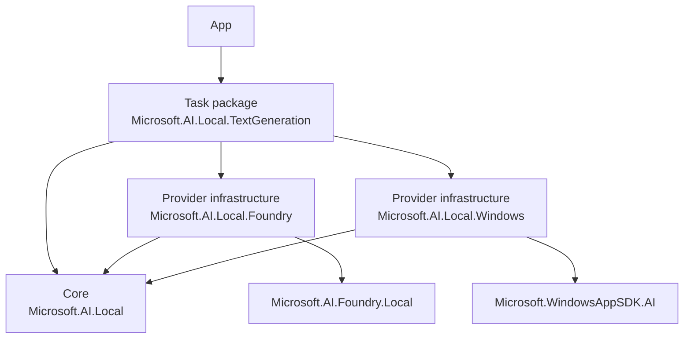

# Architecture

This document explains how the repository is put together: what each package does, how a model handle like `LanguageModels.Phi4Mini` finds its implementation, and what to touch when you add something. For the design rationale, see [PROPOSAL.md](PROPOSAL.md).

## The big picture

Apps write code against **tasks** (text generation, OCR, ...), not against providers. The model handle is the only provider-specific line:

```csharp
ITextGenerationModel model = LanguageModels.Phi4Mini;   // or LanguageModels.PhiSilica
await model.EnsureReadyAsync();
using IChatClient chat = await model.CreateClientAsync();
```

To make that work, the code is split into four kinds of packages:



| Kind | Example | What's in it | Depends on |
|---|---|---|---|
| **Core** | `Microsoft.AI.Local` | Everything every task shares: `ILocalModel` (availability, download progress, `EnsureReadyAsync`), `ImageFrame`, errors, `LocalModel.SelectFirstAvailableAsync`, and the model catalog types. Also ships the build-time analyzers. | Only `Microsoft.Extensions.*.Abstractions` |
| **Task** (11) | `Microsoft.AI.Local.TextGeneration` | One task's API (model interface `ITextGenerationModel`, client contract, options and results, DI helpers), its catalog class (`LanguageModels`), and **every provider's models of that task** (under `Windows/` and `Foundry/` in the project). | Core and the infrastructure of each provider it has models from |
| **Provider infrastructure** (2) | `Microsoft.AI.Local.Foundry`, `Microsoft.AI.Local.Windows` | Plumbing shared by all of a provider's tasks: the Foundry Local runtime, the Phi Silica unlock, identity checks, options, and base classes. **No models.** | Core and the provider's SDK |
| **Building block** (1) | `Microsoft.AI.Local.Audio` | Media plumbing some tasks share but no model owns: microphone capture, live audio streams, WAV decoding and resampling. | Nothing |

Why split this way:

- **By task**, so each task's API can version independently, and an app only carries the tasks it uses. A breaking change in text generation doesn't touch OCR, and an inbox-only OCR app never gets ONNX Runtime or the text-generation API.
- **One package per task**, so referencing a task gives the app every model of it. Every catalog handle works without extra packages, and switching models really is a one-line change.

Task packages share only the core and the provider infrastructure. Even cross-task helpers follow that rule: `AsTextSummarizationModel()` takes the core type `ILocalModel<IChatClient>`, so the summarization package doesn't depend on the text-generation package.

## How a model handle finds its implementation

A handle and its implementation live in the same task package, so the catalog generator binds them at build time:

```
 eng/catalog/*-models.json ──(build: catalog generator)──► LanguageModels.Phi4Mini => FoundryModelFactory.Create(descriptor)
```

1. **Manifests list the models.** Each provider has a checked-in manifest in [eng/catalog](eng/catalog) (`windows-models.json`, `foundry-models.json`). Each entry has the model's alias, task, catalog property name, capabilities and platforms.
2. **The catalog generator writes the catalog.** [Microsoft.AI.Local.Catalog.Generators](src/Microsoft.AI.Local.Catalog.Generators) runs while each task package builds. It emits the catalog class (`LanguageModels.PhiSilica`, `LanguageModels.Phi4Mini`, ...) from *all* manifests, plus an internal `<Task>Catalog` class with each model's descriptor. Each property is tagged `[LocalModelProvider("<Provider>")]` and returns a lazily created, cached handle from the provider's `<Provider>ModelFactory.Create(descriptor)` in the same assembly. There's no registration and no reflection, so trimming and Native AOT keep working.
3. **The generator checks the package covers the manifests.** `LocalAIProviders` (derived from `LocalAIWindowsTasks` and `LocalAIFoundryTasks` in [src/Directory.Build.props](src/Directory.Build.props)) lists the providers a task package implements. If a manifest has models of the task from a provider the package doesn't implement, or the other way around, the build fails with `MSAILOCALGEN003`.

The handle and the implementation are generated from the same manifest entry, so their IDs and capabilities always match. A model that can't run where the app runs never throws from the handle: Windows models report `NotSupportedOnPlatform` off Windows and in the `net8.0` build, so `SelectFirstAvailableAsync` can move on to the next model.

## Audio input: capture is separate from recognition

Speech models need audio, but where the audio comes from (a file, a microphone, a call) has nothing to do with which model transcribes it. So capture lives in its own package, [Microsoft.AI.Local.Audio](src/Microsoft.AI.Local.Audio), and every source reaches every model through one standard format: **a WAV stream**.

```
 Audio sources                                   Speech models (ISpeechToTextClient)
 ─────────────                                   ───────────────────────────────────
 File / MemoryStream (WAV, MP3, ...)  ──┐
 Microphone.StartAsync() (Windows)    ──┼─ Stream ─►  SpeechToTextModels.WindowsDefault
 PushAudioStream (app-fed audio)      ──┘             SpeechToTextModels.WhisperTiny, ...
```

- **A live source is just a `Stream`.** `MicrophoneStream` and `PushAudioStream` derive from `LiveAudioStream`: a WAV header whose length is "unknown", followed by audio as it's produced. The stream ends when the app calls `Stop()` or `Complete()`. Because the stream is plain WAV, it's the same `Stream` parameter that Microsoft.Extensions.AI's `ISpeechToTextClient` already takes, so no new client API is needed, and even speech clients outside this library can consume it.
- **Providers read audio the same way.** `AudioInput` examines any stream (container, format, live or not), and `PcmAudioReader` converts it to the 16-bit PCM format the model needs (resampling and mixing channels) as the audio arrives.
- **Each model uses what it supports.** The Windows recognizer pushes PCM into its native streaming recognizer, so live audio gets partial results while the user speaks. Foundry models stream live audio into an `AudioSession`, and fall back to transcribing the whole audio when the stream ends if a model can't transcribe live. Every source works with every model either way.
- **Platform code stays at the edge.** Only `Microphone` is platform-specific (Windows uses an `AudioGraph`, in `*.Windows.cs`). Adding capture for another platform, or another source such as a network stream, doesn't touch any model code.

The Windows speech model is **experimental**: `Microsoft.AI.Local.SpeechToText` is the only package that depends on the experimental Windows App SDK (`Microsoft.WindowsAppSDK.AI` 2.5.4-experimental). The other task packages require a *lower* stable version (2.4.4), so NuGet picks the experimental build in apps that use speech, and the stable one everywhere else. If something forces a stable version anyway, build warning `MSAILOCAL104` and a `MissingAppRequirement` explain why.

## What a provider implements in a task package

The generator writes the catalog and the descriptors. For each of its tasks, a provider writes only two things in the task package, under `<Provider>/`:

- An internal `<Provider>ModelFactory.Create(LocalModelDescriptor)` method that the generated catalog calls.
- The model and client classes, built on the base classes in the infrastructure package.

| Provider | Base class to derive from | Notes |
|---|---|---|
| Windows | `WindowsModelBase<TClient>` (or `WindowsLanguageModelBase<TClient>` for models that run on Phi Silica) | Implement the native ready check, the native `EnsureReadyAsync`, and client creation. Optionally override `CheckModelRequirements` and `TryMapException` for model-specific requirements (the speech model checks the Windows build and the experimental SDK). Put that code in `*.Windows.cs` files. A `*.Portable.cs` factory returns `WindowsUnsupportedModel<TClient>` for the `net8.0` build, which reports `NotSupportedOnPlatform`. |
| Foundry | `FoundryModelHandle<TClient>` | Implement `CreateClient(variant, lease)`. Initialization, execution-provider and model download, loading, `WithDevice`, and unloading are inherited. |

All providers end up on `LocalModelBase<TClient>` in the core. It provides the behavior every model shares: concurrent `EnsureReadyAsync` calls are merged into one download, cancellation is reference-counted across callers, progress is normalized, and logging and telemetry are built in.

## Build conventions: the project name drives everything

Task projects hold the task's code, but their `.csproj` holds only a description. [src/Directory.Build.props](src/Directory.Build.props) reads the project name, and [src/Directory.Build.targets](src/Directory.Build.targets) uses it to set up the build:

| Project name | Becomes | Gets automatically |
|---|---|---|
| `Microsoft.AI.Local.<Task>` (listed in `LocalAITasks`) | Task package | A reference to the core, the catalog generator, the shared helpers it needs from [src/Shared](src/Shared), and for each provider that implements the task (`LocalAIWindowsTasks`, `LocalAIFoundryTasks`): a reference to the provider infrastructure package. Tasks with Windows models build for `net8.0` and a Windows TFM; the others build for `net8.0` only. |

[src/Shared](src/Shared) holds internal helpers, such as the lazy clients and the chat-backed adapters. They are compiled *into* each task package that needs them, instead of being a shared package, so the task packages stay independent.

Versions are in [eng/Versions.props](eng/Versions.props), one version per task package.

## Common changes

**Add a model:** add an entry to the provider's manifest in [eng/catalog](eng/catalog). The task's catalog class picks it up on the next build. If the model needs model-specific behavior, handle it in the provider's `<Provider>ModelFactory.Create` in the task package.

**Add a provider for an existing task** (Windows speech-to-text is a recent example):
1. Add the models to that provider's manifest.
2. Add the task to `LocalAI<Provider>Tasks` in [src/Directory.Build.props](src/Directory.Build.props).
3. Add a `<Provider>/` folder to the task package with a `<Provider>ModelFactory` plus model classes.

**Add an audio source** (a platform's microphone, a network stream, ...): implement it in [Microsoft.AI.Local.Audio](src/Microsoft.AI.Local.Audio) as a `LiveAudioStream`. Every speech model accepts it without changes.

**Add a task:**
1. Create `src/Microsoft.AI.Local.<Task>/` with the model interface, the client contract, an empty `public static partial class <Task>Models`, and a `<Provider>/` folder per provider that implements it.
2. Add the task's name to `LocalAITasks` and the matching `LocalAI<Provider>Tasks` in [src/Directory.Build.props](src/Directory.Build.props), to `CatalogTask.All` in [CatalogManifest.cs](src/Microsoft.AI.Local.Catalog.Generators/CatalogManifest.cs), and to [eng/Versions.props](eng/Versions.props).
3. If the task needs any of the [src/Shared](src/Shared) helpers, add it to the matching condition in [src/Directory.Build.targets](src/Directory.Build.targets).

**Add a provider** (a new runtime):
1. Create a manifest `eng/catalog/<provider>-models.json`.
2. Create an infrastructure package `Microsoft.AI.Local.<Provider>` with its base classes.
3. Add `LocalAI<Provider>Tasks` and the matching references in [src/Directory.Build.props](src/Directory.Build.props) and [src/Directory.Build.targets](src/Directory.Build.targets), and implement the models in each task package under `<Provider>/`.

## Repository map

```
src/
  Microsoft.AI.Local/                     core
  Microsoft.AI.Local.<Task>/              task packages (11): API, catalog, Windows/ and Foundry/ models
  Microsoft.AI.Local.Windows/             Windows provider infrastructure
  Microsoft.AI.Local.Foundry/             Foundry provider infrastructure
  Microsoft.AI.Local.Audio/               microphone capture, live audio streams, WAV and resampling
  Microsoft.AI.Local.Analyzers/           analyzers (shipped inside the core)
  Microsoft.AI.Local.Catalog.Generators/  catalog generator (build-time only, not shipped)
  Shared/                                 internal helpers compiled into task packages
eng/
  catalog/<provider>-models.json          the model lists
  Versions.props                          one version per task package
tests/
  Microsoft.AI.Local.Tests/               runs like an app: catalog binding, audio, speech clients
  Microsoft.AI.Local.Analyzers.Tests/     generator and analyzer tests on in-memory compilations
pack.ps1                                  builds all 15 packages into artifacts/packages
```

## Build, test, pack

```powershell
dotnet build Microsoft.AI.Local.slnx
dotnet test Microsoft.AI.Local.slnx
.\pack.ps1 -VersionSuffix local.1        # local NuGet feed in artifacts\packages
```
